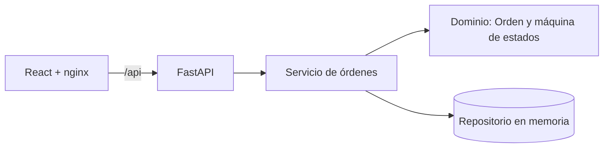
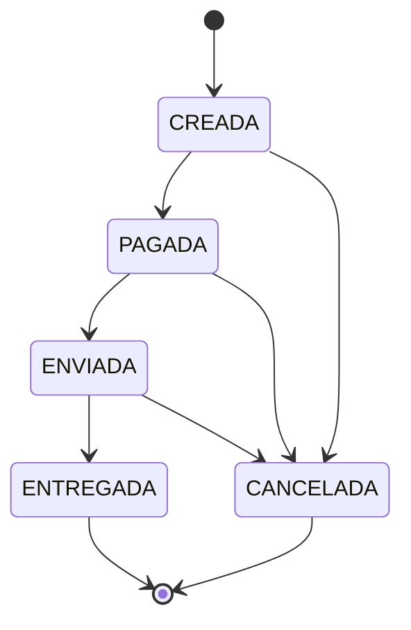

# Plantillas de documentación

Reemplaza lo que va entre `<...>`. Borra las secciones del frontend o E2E solo si no se entregaron.

Contenido:
1. README.md
2. docs/TEST_STRATEGY.md
3. ADR (plantilla y los 3 del reto)
4. docs/AI_USAGE.md
5. CHANGELOG.md

---

## 1. README.md

````markdown
# API de órdenes de compra


Solución al reto técnico de Ingeniero/a de Software QA: una API REST para gestionar órdenes de compra con reglas de negocio validadas en cuatro niveles de prueba, quality gates automáticos y despliegue con Docker.

| Indicador | Resultado | Mínimo |
|---|---|---|
| Cobertura de líneas | <xx> % | 80 % |
| Cobertura de ramas | <xx> % | 80 % |
| Mutation score | <xx> % | 70 % |
| Escenarios Karate | <n> en verde | 4 obligatorios |
| Flujos E2E | <n> en verde | — |

## Descripción de la solución

<2–3 frases: qué hace, qué stack, qué incluye además de lo obligatorio.>

## Arquitectura



Arquitectura hexagonal ligera: el dominio no depende de FastAPI, lo que permite probar las reglas con pruebas unitarias puras. Ver [ADR-001](docs/adr/001-arquitectura-hexagonal.md).

```
backend/            API (FastAPI) y pruebas pytest
acceptance-tests/   Karate
frontend/           React + Vite + TypeScript, Playwright en e2e/
docs/               estrategia, trazabilidad, ADR, evidencias
.github/workflows/  pipeline
```

### Máquina de estados



## Decisiones técnicas

| Decisión | Por qué |
|---|---|
| FastAPI + Pydantic v2 | Validación declarativa y OpenAPI automático en `/docs` |
| Dominio sin dependencias del framework | Pruebas unitarias rápidas y mutation testing eficaz (ADR-001) |
| Persistencia en memoria detrás de una interfaz | El foco del reto es la calidad; se cambia sin tocar el dominio (ADR-002) |
| Errores en formato Problem Details (RFC 9457) con `codigo` de regla | Contrato de error uniforme y trazable a RN-xx (ADR-003) |
| Dinero en enteros | Evita errores de redondeo de `float` |
| `DELETE` como cancelación lógica | Una orden de compra es un registro auditable; no se borra |
| Logs JSON con `X-Request-ID` | Correlacionar una petición entre Karate, Playwright y la API |

### Supuestos

- Una orden ENVIADA puede cancelarse: RN-04 solo prohíbe cancelar una ENTREGADA.
- Validaciones de payload (RN-01, RN-02) responden 422; enviar sin pagar responde 400 y los conflictos de estado 409, como piden los escenarios del enunciado.
- El cliente no puede enviar `total`: si lo hace, se rechaza con 422 (RN-03).

### Códigos de respuesta

| Situación | Código | `codigo` |
|---|---|---|
| Orden creada | 201 | — |
| Payload inválido (RN-01, RN-02) | 422 | `VALIDACION` |
| Enviar sin pagar (RN-05) | 400 | `RN-05` |
| Cancelar o cambiar una orden terminal (RN-04) | 409 | `RN-04` |
| Transición inválida (RN-06) | 409 | `RN-06` |
| Orden inexistente | 404 | `NO_ENCONTRADA` |

## Cómo ejecutar la aplicación

Requisitos: Docker Desktop.

```bash
docker compose up -d --build --wait
```

- API: http://localhost:8080 (Swagger en http://localhost:8080/docs)
- Web: http://localhost:3000

Solo la API, como indica el enunciado:
```bash
docker build -t challenge-api ./backend
docker run -p 8080:8080 challenge-api
```

Sin Docker (Python 3.12):
```powershell
cd backend
python -m venv .venv
.venv\Scripts\activate
pip install -r requirements-dev.txt
uvicorn app.main:app --reload --port 8080
```

## Cómo ejecutar las pruebas

| Nivel | Comando | Requisitos |
|---|---|---|
| Unitarias e integración + cobertura | `cd backend && pytest --cov=app --cov-branch --cov-report=html` | Python 3.12 |
| Mutation testing | `cd backend && mutmut run && mutmut export-cicd-stats && python scripts/check_mutation_score.py` | Linux o WSL |
| Aceptación (Karate) | `docker compose up -d --wait api` y `mvn -B test -f acceptance-tests/pom.xml` | JDK 17, Maven |
| Componentes (Vitest) | `cd frontend && npm test -- --run` | Node 24 |
| E2E (Playwright) | `docker compose up -d --build --wait` y `cd frontend && npx playwright test` | Node 24 |
| Trazabilidad | `python scripts/generar_trazabilidad.py --salida docs/TRACEABILITY.md` | Python |

Estrategia completa en [TEST_STRATEGY.md](docs/TEST_STRATEGY.md) y matriz en [TRACEABILITY.md](docs/TRACEABILITY.md).

## Evidencia de cobertura


<Cifras y comentario breve: qué queda sin cubrir y por qué.>

## Evidencia de mutation testing


Se mutan `app/domain` y `app/application`, donde vive la lógica de negocio.

### Mutantes aceptados

| Mutante | Por qué se acepta |
|---|---|
| <nombre> | <equivalente: por ejemplo, cambia el texto de un mensaje de error que no forma parte del contrato> |

## Evidencia del pipeline

Última ejecución en verde: <enlace a la ejecución de GitHub Actions>


| Quality gate | Falla si |
|---|---|
| Pruebas | hay alguna prueba fallida (pytest, Karate, Vitest, Playwright) |
| Cobertura | líneas o ramas < 80 % |
| Mutation score | < 70 % |
| Trazabilidad | una regla RN-xx queda sin pruebas |

## Uso de IA

Ver [AI_USAGE.md](docs/AI_USAGE.md).
````

---

## 2. docs/TEST_STRATEGY.md

```markdown
# Estrategia de pruebas

## Enfoque

Las pruebas se priorizan por riesgo: probabilidad de que algo falle por su impacto en el negocio. Los riesgos altos tienen pruebas en varios niveles; los bajos, en uno.

## Matriz de riesgo

| Riesgo | Probabilidad | Impacto | Nivel | Mitigación |
|---|---|---|---|---|
| Se permite una transición de estado inválida (RN-04, RN-05, RN-06) | Media | Alto: se entrega sin pago o se cancela lo ya entregado | Alto | Matriz unitaria de 25 combinaciones, Karate y E2E |
| Total mal calculado o manipulado por el cliente (RN-03) | Media | Alto: pérdida económica | Alto | Unitarias + propiedades (Hypothesis), rechazo de `total` en API y Karate |
| Orden sin productos o con cantidades inválidas (RN-01, RN-02) | Alta | Medio | Medio | Fronteras unitarias, integración y Scenario Outline en Karate |
| Error de contrato HTTP (código o formato de error) | Media | Medio: rompe consumidores | Medio | Integración con TestClient y validación de esquema en Karate |
| Condiciones de carrera en el repositorio | Baja | Medio | Bajo | Lock en el repositorio; sin prueba de concurrencia dedicada |
| Fallo de despliegue | Baja | Alto | Medio | Healthcheck, prueba de humo del contenedor en CI |

## Pirámide

| Nivel | Herramienta | Cantidad | Qué valida |
|---|---|---|---|
| Unitarias | pytest + Hypothesis | <n> | Reglas de dominio y servicio |
| Integración | pytest + TestClient | <n> | Contrato HTTP y manejo de errores |
| Aceptación | Karate | <n> | API desplegada en Docker, flujos de negocio |
| Componentes | Vitest + Testing Library | <n> | Lógica de la UI |
| E2E | Playwright | <n> | Flujos completos por la interfaz |

La base es ancha porque el riesgo principal está en la lógica de dominio, que se prueba en milisegundos. Las E2E son pocas: confirman que las piezas están conectadas, no repiten las reglas.

## Técnicas aplicadas

- Partición de equivalencia y valores frontera (cantidades −1, 0, 1).
- Tabla de decisión completa para la máquina de estados.
- Pruebas basadas en propiedades para el cálculo del total.
- Mutation testing para medir la calidad de las pruebas, no solo la cobertura.
- Arrange por API en E2E para aislar el comportamiento bajo prueba.

## Fuera de alcance

- Rendimiento y carga.
- Seguridad (autenticación, autorización): el enunciado no la pide.
- Persistencia real: la interfaz del repositorio permite agregarla después.

## Quality gates

Cobertura ≥ 80 % (líneas y ramas), mutation score ≥ 70 %, cero pruebas fallidas y todas las reglas con al menos una prueba. Todos automáticos en el pipeline.
```

---

## 3. ADR

### Plantilla: docs/adr/NNN-titulo.md
```markdown
# ADR-NNN: <título>

- Estado: aceptada
- Fecha: <AAAA-MM-DD>

## Contexto
<qué problema o pregunta hay>

## Decisión
<qué se decidió>

## Alternativas consideradas
<opción>: <por qué no>

## Consecuencias
<qué se gana, qué se pierde, qué habría que hacer si cambia el contexto>
```

### Contenido sugerido para los 3 ADR

- **001 Arquitectura hexagonal ligera.** Contexto: reglas de negocio que deben probarse a fondo, incluido mutation testing. Decisión: dominio sin dependencias de FastAPI ni Pydantic; capas `api → application → domain`. Alternativa: lógica en los endpoints (más rápido de escribir, pero las pruebas necesitan HTTP y el mutation testing se vuelve lento y ruidoso). Consecuencia: algo más de código de mapeo entre schemas y dominio.
- **002 Persistencia en memoria.** Contexto: el enunciado no exige base de datos y el plazo es corto. Decisión: repositorio en memoria con lock detrás de la interfaz `OrderRepository`. Alternativa: SQLite o PostgreSQL (más realista, pero suma configuración y no aporta a lo que se evalúa). Consecuencia: los datos se pierden al reiniciar; cambiar a una base real solo requiere otra implementación de la interfaz.
- **003 Política de códigos HTTP.** Contexto: el enunciado pide 400 al enviar sin pagar y 409 al cancelar una entregada. Decisión: 422 para payload inválido, 400 para la precondición de pago (RN-05), 409 para conflictos de estado (RN-04, RN-06), 404 para inexistentes; todo con Problem Details y `codigo`. Alternativa: 400 para todo (más simple, pero pierde información para el consumidor). Consecuencia: contrato más rico y trazable a las reglas.

---

## 4. docs/AI_USAGE.md

```markdown
# Uso de inteligencia artificial

## Herramientas

| Herramienta | Uso |
|---|---|
| <Claude / GitHub Copilot> | <planificación, código base, generación de casos de prueba, revisión> |

## Cómo se usó

- <Tarea>: <qué produjo la IA> → <qué revisé o cambié>.

## Revisión humana

Todo el código generado se revisó y se ejecutó. Las pruebas se validaron con mutation testing: una prueba generada que no mata mutantes no aporta, aunque pase.

## Sugerencias corregidas o descartadas

- <Ejemplo: la IA calculaba el resultado esperado de la matriz de transiciones leyendo el diccionario de producción; se reemplazó por una tabla literal porque así la prueba nunca fallaba ante un cambio.>
- <Ejemplo 2>

## Límites

<Qué no se delegó a la IA y por qué: por ejemplo, las decisiones de los ADR y los supuestos de negocio.>
```

---

## 5. CHANGELOG.md

```markdown
# Changelog

Formato basado en [Keep a Changelog](https://keepachangelog.com/es-ES/1.1.0/) y versionado semántico.

## [1.0.0] - <AAAA-MM-DD>

### Agregado
- API REST de órdenes con reglas RN-01 a RN-06.
- Pruebas unitarias, de integración, Karate, Vitest y Playwright.
- Cobertura, mutation testing y quality gates en GitHub Actions.
- Docker y docker-compose.
- Frontend en React.
- Matriz de trazabilidad automática.
```
