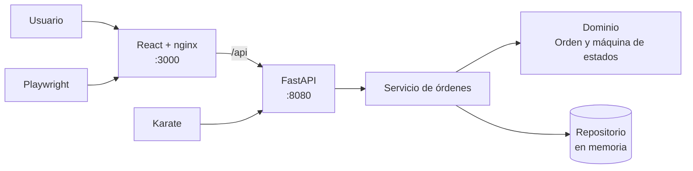
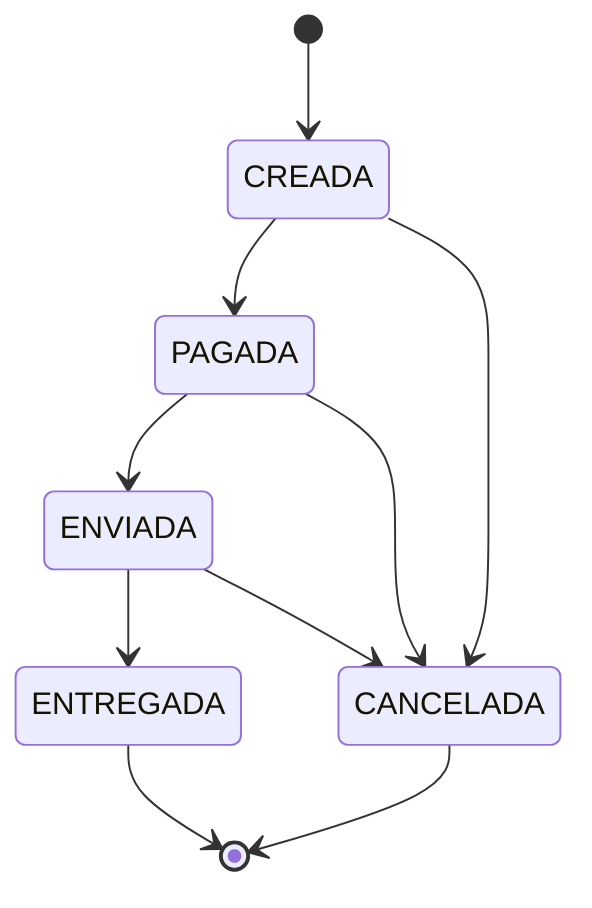
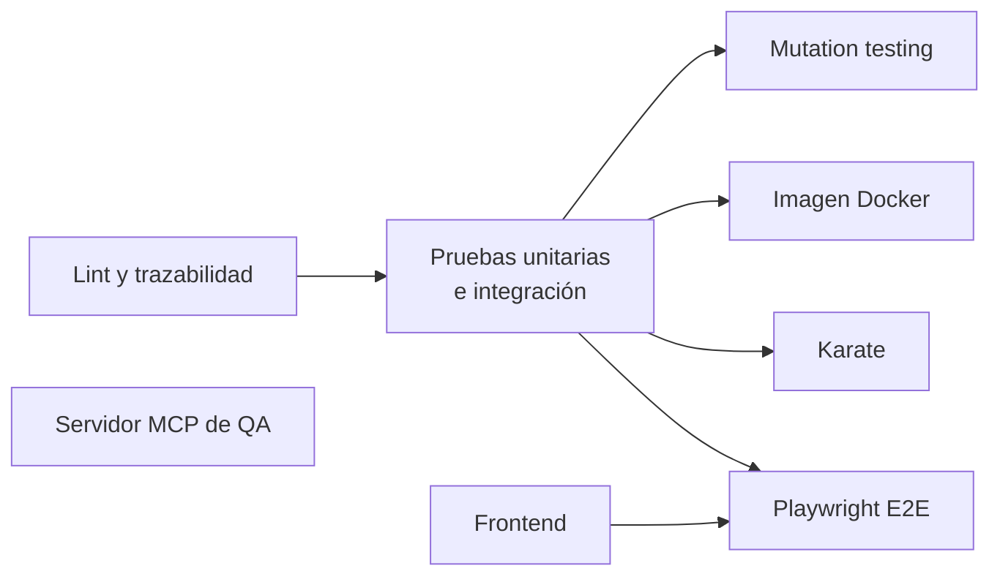
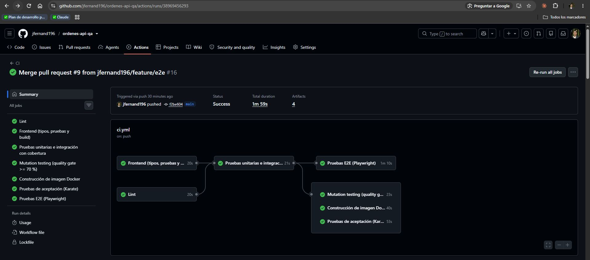
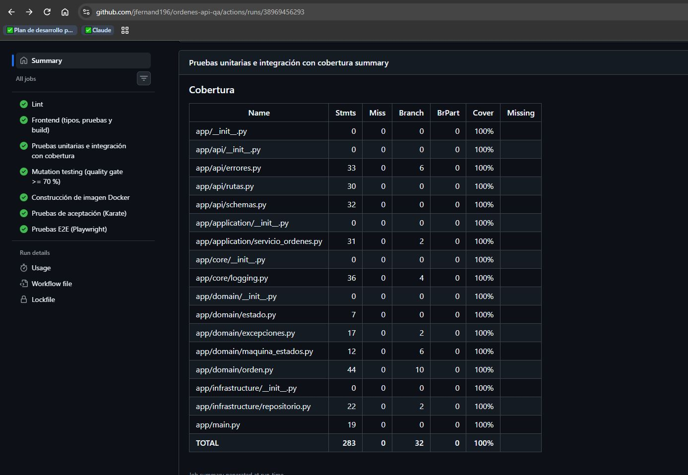
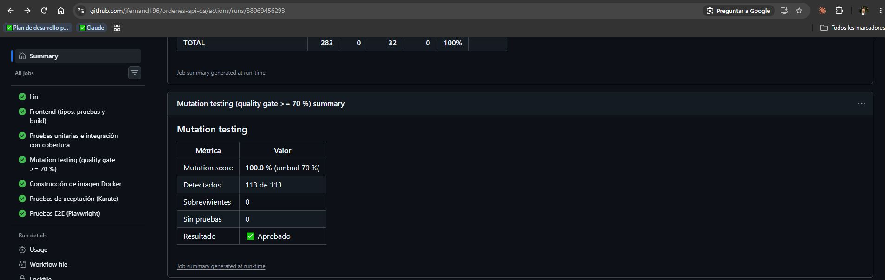
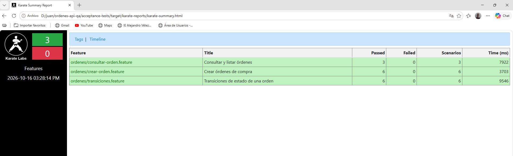
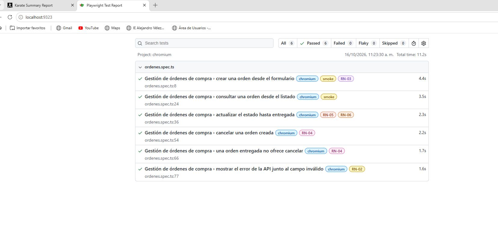

# API de órdenes de compra

[](https://github.com/jfernand196/ordenes-api-qa/actions/workflows/ci.yml)

Solución al reto técnico de **Ingeniero/a de Software QA**: una API REST para gestionar órdenes de compra con sus reglas de negocio verificadas en cuatro niveles de prueba, quality gates automáticos en cada pull request, despliegue con Docker y una interfaz web en React.

| Indicador | Resultado | Mínimo del reto |
|---|---|---|
| Cobertura de líneas | **100 %** | 80 % |
| Cobertura de ramas | **100 %** | 80 % |
| Mutation score | **100 %** (113 de 113 mutantes) | 70 % |
| Pruebas unitarias e integración (pytest) | **99** | — |
| Escenarios de aceptación (Karate) | **22** (4 obligatorios + 18 justificados) | 4 |
| Pruebas de componentes (Vitest) | **7** | — |
| Flujos E2E (Playwright) | **6** | — |
| Jobs del pipeline | **8**, todos en verde | — |

## Contenido

- [Descripción de la solución](#descripción-de-la-solución)
- [Arquitectura](#arquitectura)
- [Decisiones técnicas](#decisiones-técnicas)
- [Cómo ejecutar la aplicación](#cómo-ejecutar-la-aplicación)
- [Cómo ejecutar las pruebas](#cómo-ejecutar-las-pruebas)
- [Estrategia de calidad](#estrategia-de-calidad)
- [Evidencias](#evidencias)
- [Servidor MCP de QA](#servidor-mcp-de-qa)
- [Uso de IA](#uso-de-ia)

## Descripción de la solución

- **Backend:** API REST en Python 3.12 con FastAPI. Implementa las reglas RN-01 a RN-06 con una máquina de estados explícita, devuelve errores en formato Problem Details (RFC 9457) con el código de la regla que los produce, y registra logs en JSON con `X-Request-ID` para trazar cada petición.
- **Pruebas:** pytest (unitarias, integración y por propiedades con Hypothesis), mutmut, Karate, Vitest y Playwright, cada prueba etiquetada con la regla que verifica.
- **Despliegue:** Docker y docker-compose; la API en el puerto 8080 y la web en el 3000.
- **CI/CD:** GitHub Actions con 8 jobs y quality gates de lint, tipos, cobertura, mutation score, trazabilidad, pruebas fallidas e imagen Docker.
- **Frontend (plus):** React + Vite + TypeScript, servido con nginx.

## Arquitectura



El backend sigue una **arquitectura hexagonal ligera**: el dominio no depende de FastAPI ni de Pydantic, y el servicio depende de una interfaz de repositorio, no de su implementación. Ver [ADR-001](docs/adr/001-arquitectura-hexagonal.md).

```
backend/
  app/domain/          Estado, excepciones, máquina de estados, Orden
  app/application/     Servicio de órdenes (casos de uso) y puertos (interfaces)
  app/infrastructure/  Repositorio en memoria
  app/api/             Endpoints, schemas y manejo de errores
  app/core/            Logging JSON y X-Request-ID
  tests/               Pruebas unitarias e integración
  scripts/             Quality gate de mutation testing
acceptance-tests/      Karate (Maven, Java 17)
frontend/              React + Vite + TypeScript; e2e/ con Playwright
scripts/               Generador de la matriz de trazabilidad
docs/                  Estrategia de pruebas, trazabilidad, ADR, evidencias
.claude/skills/        Skills de Claude usados en el desarrollo (ver Uso de IA)
.github/workflows/     Pipeline de CI
```

### Máquina de estados



### Reglas de negocio

| Regla | Dónde se aplica |
|---|---|
| RN-01: al menos un producto | Schema (`min_length=1`) y entidad `Orden` |
| RN-02: cantidad mayor que cero | Schema (`gt=0`) y entidad `LineaProducto` |
| RN-03: total calculado automáticamente | Propiedad `Orden.total`; el schema rechaza un `total` enviado por el cliente |
| RN-04: una orden entregada no se cancela | ENTREGADA es estado terminal en la máquina de estados |
| RN-05: no se envía sin pagar | CREADA → ENVIADA lanza `PagoRequeridoError` |
| RN-06: sin transiciones inválidas | Tabla `TRANSICIONES` de la máquina de estados |

## Decisiones técnicas

| Decisión | Por qué |
|---|---|
| FastAPI + Pydantic v2 | Validación declarativa y documentación OpenAPI automática en `/docs` |
| Dominio sin dependencias del framework | Pruebas unitarias rápidas y mutation testing eficaz ([ADR-001](docs/adr/001-arquitectura-hexagonal.md)) |
| Repositorio en memoria detrás de una interfaz | El foco del reto es la calidad; cambiar a una base de datos solo requiere otra clase ([ADR-002](docs/adr/002-persistencia-en-memoria.md)) |
| Interfaz del repositorio en la capa de aplicación (`puertos.py`) | Inversión de dependencias: la aplicación define lo que necesita y la infraestructura lo implementa |
| Validación en el schema y en el dominio | Defensa en profundidad: el schema protege la API y el dominio protege sus invariantes venga de donde venga la orden |
| Español para el negocio; inglés donde el enunciado o el framework lo fijan | Rutas (`/orders`), parámetros (`limit`, `offset`), `create_app()` y `/health` siguen el enunciado y las convenciones de FastAPI; entidades, reglas, errores y pruebas usan el lenguaje del negocio |
| Errores Problem Details con `codigo` de regla | Contrato de error uniforme y trazable a RN-xx ([ADR-003](docs/adr/003-politica-codigos-http.md)) |
| Dinero en enteros | Evita errores de redondeo de `float` |
| `DELETE` como cancelación lógica | Una orden de compra es un registro auditable; no se borra |
| `201` con header `Location` | Indica dónde quedó el recurso creado (buena práctica REST) |
| Logs JSON con `X-Request-ID` | Una petición se sigue de punta a punta entre Karate o Playwright, nginx y la API |
| La web consume `transicionesPermitidas` | El frontend no duplica la máquina de estados: la API es la fuente de verdad |

### Supuestos

- **Una orden ENVIADA puede cancelarse.** RN-04 solo prohíbe cancelar una orden ENTREGADA. Está verificado por el escenario Karate "Cancelar una orden enviada".
- **Códigos HTTP:** el enunciado pide 400 al enviar una orden no pagada y 409 al cancelar una entregada. Se generalizó así: precondición de pago → 400; conflicto de estado → 409; payload inválido → 422.
- **El cliente no envía el total:** si lo hace, la API responde 422 (RN-03).
- `PATCH /orders/{id}/status` y `DELETE /orders/{id}` vienen fijados por el enunciado; se respetan aunque no sean REST puro.

### Contrato de errores

| Situación | Código | `codigo` |
|---|---|---|
| Orden creada | 201 | — |
| Payload inválido (RN-01, RN-02, total enviado) | 422 | `VALIDACION` |
| Enviar sin pagar (RN-05) | 400 | `RN-05` |
| Cancelar o cambiar una orden en estado terminal (RN-04) | 409 | `RN-04` |
| Transición inválida (RN-06) | 409 | `RN-06` |
| Orden inexistente | 404 | `NO_ENCONTRADA` |

Ejemplo de error:

```json
{
  "type": "https://errores.ordenes.local/rn-05",
  "title": "La orden no ha sido pagada",
  "status": 400,
  "detail": "La orden no puede enviarse si no ha sido pagada.",
  "instance": "/orders/6026428a-57bf-4ae1-b9c2-ed05b404bb29/status",
  "codigo": "RN-05"
}
```

## Cómo ejecutar la aplicación

Requisito: Docker.

```bash
docker compose up -d --build --wait
```

- **Web:** http://localhost:3000
- **API:** http://localhost:8080, con la documentación interactiva en http://localhost:8080/docs

Solo la API, con los comandos del enunciado:

```bash
docker build -t challenge-api .
docker run -p 8080:8080 challenge-api
```

### Sin Docker

Backend (Python 3.12 o superior):

```bash
cd backend
python -m venv .venv
.venv\Scripts\activate        # Windows; en Linux o macOS: source .venv/bin/activate
pip install -r requirements-dev.txt
uvicorn app.main:app --reload --port 8080
```

Frontend (Node 24), con la API corriendo en el puerto 8080:

```bash
cd frontend
npm ci
npm run dev                    # http://localhost:5173
```

## Cómo ejecutar las pruebas

| Nivel | Comando | Requisitos |
|---|---|---|
| Unitarias e integración + cobertura | `cd backend && pytest --cov=app --cov-branch --cov-report=html` | Python 3.12+ |
| Mutation testing | `cd backend && mutmut run && mutmut export-cicd-stats && python scripts/check_mutation_score.py --umbral 70` | Linux o WSL (mutmut no funciona en Windows nativo) |
| Aceptación (Karate) | Ver abajo | Docker |
| Componentes (Vitest) | `cd frontend && npm test -- --run` | Node 24 |
| E2E (Playwright) | `docker compose up -d --build --wait` y luego `cd frontend && npx playwright install chromium && npx playwright test` | Node 24, Docker |
| Tipos (mypy, modo estricto) | `cd backend && mypy app` | Python 3.12+ |
| Trazabilidad | `python scripts/generar_trazabilidad.py --salida docs/TRACEABILITY.md --estricto` | Python |

Karate, con Java 17 y Maven instalados:

```bash
docker compose up -d --build --wait api
mvn -B test -f acceptance-tests/pom.xml
```

O sin instalar Java ni Maven, con un contenedor (PowerShell):

```powershell
docker compose up -d --build --wait api
docker run --rm -v "${PWD}\acceptance-tests:/app" -v maven-repo:/root/.m2 -w /app `
  maven:3.9-eclipse-temurin-17 mvn -B test "-DbaseUrl=http://host.docker.internal:8080"
```

El reporte queda en `acceptance-tests/target/karate-reports/karate-summary.html`.

## Estrategia de calidad

La estrategia completa está en [TEST_STRATEGY.md](docs/TEST_STRATEGY.md): matriz de riesgo, pirámide de pruebas, técnicas aplicadas y lo que quedó fuera de alcance. En resumen:

- **Pruebas priorizadas por riesgo.** Las transiciones de estado y el cálculo del total, de mayor impacto económico, se prueban en todos los niveles; entre otras cosas, con una tabla literal de las 25 combinaciones origen → destino.
- **Pirámide.** 79 pruebas unitarias, 20 de integración, 22 escenarios Karate, 7 pruebas de componentes y 6 flujos E2E. La base es ancha porque el riesgo principal está en el dominio, que se prueba en milisegundos.
- **Mutation testing, porque la cobertura no basta.** La primera corrida dio **58,4 %** con **100 % de cobertura**: el código se ejecutaba, pero no se verificaban los logs, los mensajes de error, el límite de paginación ni la llamada a `guardar`. Con las pruebas que faltaban, el score llegó a **100 %**. No hay mutantes aceptados.
- **Trazabilidad.** Cada prueba lleva la regla que verifica (`@pytest.mark.rn("RN-04")`, `@RN-04` en Karate y en Playwright), y [TRACEABILITY.md](docs/TRACEABILITY.md) se genera automáticamente con la matriz regla → pruebas en los tres niveles.

### Quality gates

Todos corren automáticamente en cada pull request:

| Gate | Falla si |
|---|---|
| Lint y tipos | ruff encuentra errores o código sin formatear, o mypy (modo estricto) encuentra errores de tipos |
| Pruebas | falla cualquier prueba (pytest, Karate, Vitest o Playwright) |
| Cobertura | líneas o ramas < 80 % |
| Mutation score | < 70 % |
| Trazabilidad | una regla queda sin pruebas o la matriz está desactualizada |
| Docker | la imagen no construye o la API y la web no responden |

### Pipeline



### Versionamiento

- Ramas `feature/*` integradas con pull requests; cada PR documenta qué incluye, las decisiones y su verificación.
- Commits con [Conventional Commits](https://www.conventionalcommits.org/es/v1.0.0/) (`feat`, `fix`, `test`, `build`, `ci`, `docs`, `style`).
- [CHANGELOG.md](CHANGELOG.md) y tag `v1.0.0`.

## Evidencias

### Pipeline

Ejecuciones: [GitHub Actions](https://github.com/jfernand196/ordenes-api-qa/actions/workflows/ci.yml)



### Cobertura



### Mutation testing



### Pruebas de aceptación (Karate)



### Pruebas E2E (Playwright)



Cada ejecución del pipeline publica además los reportes completos como artifacts: `cobertura`, `mutation`, `karate` y `playwright`.

## Servidor MCP de QA

[`mcp-qa/`](mcp-qa) es un servidor [MCP](https://modelcontextprotocol.io) que expone la información de calidad del proyecto como herramientas que un asistente de IA (por ejemplo, Claude Code) puede consultar. Es determinista, de solo lectura y no necesita clave de API. Ver [ADR-004](docs/adr/004-servidor-mcp-qa.md).

| Herramienta | Qué devuelve |
|---|---|
| `reglas_de_negocio` | RN-01 a RN-06, dónde se implementan y cuántas pruebas las verifican por nivel |
| `matriz_trazabilidad` | Las pruebas de cada regla en cada nivel (opcional: una sola regla) |
| `transiciones_sin_aceptacion` | Las transiciones de estado sin escenario Karate, ordenadas por riesgo (crítico, alto, medio, bajo) |
| `datos_de_prueba` | Payloads para `POST /orders` válidos, de frontera o inválidos, con el status esperado y el campo con error |

**Una sola fuente de verdad:** el servidor importa la máquina de estados, los schemas de la API y el escáner de trazabilidad del proyecto. Los límites de los datos de frontera se leen del schema (`gt=0`, `min_length=1`), y una prueba envía cada payload a la API real para comprobar que produce la respuesta que anuncia.

**Resultado:** al crearlo, `transiciones_sin_aceptacion` encontró **17 transiciones sin prueba de aceptación, 7 de ellas críticas** (salir de ENTREGADA o CANCELADA). Con esa información, Claude Code, usando este servidor y el skill `karate-aceptacion`, escribió dos `Scenario Outline` que las cubren y corrigió una limitación del detector (no expandía los `Scenario Outline`). Tras revisar el cambio y ejecutar Karate (22 escenarios en verde), **quedan 10 brechas de menor riesgo y ninguna crítica**; una prueba del servidor impide que vuelva a aparecer una crítica sin cubrir.

**Cómo usarlo con Claude Code:**

```bash
backend\.venv\Scripts\activate          # el servidor usa el entorno del backend
pip install -r mcp-qa/requirements.txt
claude                                   # en la raíz del repo; aprobar el servidor qa-ordenes
```

`.mcp.json` registra el servidor para este proyecto. En Linux o macOS, cambia `command` a `backend/.venv/bin/python`. Luego puedes preguntar, por ejemplo: *"¿qué transiciones de estado no tienen prueba de aceptación? escribe los escenarios Karate de las críticas"*. Claude obtiene las brechas del servidor y usa el skill `karate-aceptacion` para escribir los escenarios con las convenciones del proyecto.

Para probarlo sin Claude Code, con el MCP Inspector oficial (solo requiere Node):

```bash
npx @modelcontextprotocol/inspector backend/.venv/Scripts/python.exe mcp-qa/servidor.py
```

**Pruebas:** `cd mcp-qa && pytest` (en el CI: ruff, mypy estricto y pytest).

### Mejoras futuras: LangChain y LangGraph

- **LangChain:** generar borradores de escenarios Karate a partir del OpenAPI y de las brechas que reporta el servidor.
- **LangGraph:** un agente que tome una brecha, escriba el escenario, lo ejecute contra la API en Docker, lo corrija si falla y pida aprobación humana antes de abrir un PR.

Ambas requieren clave de API y revisión humana de lo generado; por eso se dejaron fuera del CI y de esta entrega.

## Uso de IA

Este proyecto se desarrolló con apoyo de Claude (Anthropic), con revisión y verificación humana en cada paso. El detalle, incluidas las sugerencias que se corrigieron o descartaron, está en [AI_USAGE.md](docs/AI_USAGE.md).

Como parte del plus de innovación, el repositorio incluye **10 skills de Claude** en [`.claude/skills/`](.claude/skills): instrucciones reutilizables que codifican las convenciones del proyecto (arquitectura, pruebas, Karate, Docker, CI, frontend, UX, buenas prácticas y documentación), para que cualquier trabajo asistido por IA siga los mismos estándares.

---

Autor: Juan Fernando Buitrago
